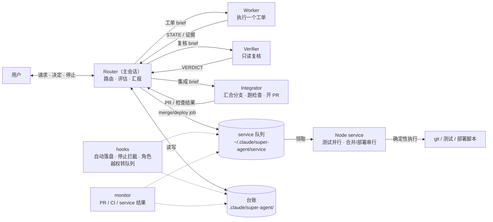

# super-agent（csg）

Claude Code 插件，把 DeepSeek《Super-agent 设计探索》的 Router/Worker 协议放到本地：主会话只负责路由、评估和汇报，具体工作交给上下文隔离的子代理按工单执行。台账存在目标项目的 `.claude/super-agent/`，会话压缩后还能接着做。当前版本 `0.3.0`。



## 它是什么

- **Router**：当前主会话。拆分请求、建工单、派子代理、汇总结果；不读大段代码，不写实现。
- **Worker**：一个工单一个子代理，在隔离上下文里调查、实现、验证，按固定字段回报状态和证据。
- **Verifier**：只读复核代理。检查 Worker 的证据和改动，返回 `VERDICT`，不改文件。
- **Integrator**：汇合代理。Router 为集成工作单独建工单，再由它在独立分支或 worktree 汇合分支，跑检查，开 PR；不直接推默认分支，不合并 PR。
- **Tester**：只跑测试和检查，不改文件、不合并、不部署。
- **Deployer**：只提交部署 job，等用户批准和 service 结果，不直接执行部署。
- **Service**：确定性 Node 服务。`fs.watch` 收 job，测试并行、同仓库合并串行、部署全局串行；LLM 只处理意图判断、失败诊断和冲突处理。

适合一个会话里有多个独立任务、需要并行子代理、等待后台任务时继续处理其他工单，或跟进 PR/CI 事件的场景。单步小任务直接用普通流程，不启用这套协议。

## 当前实现

| 部分 | 实现 |
|------|------|
| CLI 台账 | `scripts/csg.js`：建单、更新、报告入库、停止、恢复、模式、订阅、状态、事件、确认 |
| 持久化 | `ledger.json` + `ledger.md` + `events.jsonl`，原子写入，文件锁防并发覆盖 |
| hooks 自动落盘 | 会话开始和每次用户消息注入台账摘要；Worker 开始时登记 Owner；Worker 报告自动写入工单；插件 Worker 结束没回报则标 `failed`；压缩前重写台账 |
| 停止拦截 | 全局停止后，hook 拒绝新的 `Agent` 派工，以及子代理的 `Bash`、`Write`、`Edit`、`SendMessage` 等推进型调用；只读工具仍可用；`stop T#` 是终态 |
| Worker 约束 | hook 检查 brief 是否有 `TICKET`/`SOURCE_KEY`；拒绝 Worker 直接改台账；拒绝 stash、reset --hard、force push、合并/关闭 PR 等动作 |
| monitor 事件 | `monitors/monitors.json` 在交互会话启动时运行；用 `gh` 定时查 PR 状态、评审、CI，变化写入事件流；同时打印 service 结果 |
| 确定性 service | `scripts/csg-service.js`：全局 job 队列、`fs.watch`、测试并行、合并/部署串行、部署需用户批准、结果写回项目事件 |
| 角色拦截 | 插件级 `PreToolUse` 把 `git merge`、`gh pr merge`、配置里的部署命令转成 job 并拒绝直接执行；主会话同样拦截；插件需在项目启用才生效 |
| LLM 意图 hook | 高风险命令前缀使用 `type: "prompt"` hook 判断意图；不确定的 merge/deploy 由模型拒绝并提示改用 service，精确命令仍走快速路径 |
| 子代理 | `super-agent-worker`、`super-agent-verifier`、`super-agent-integrator`、`super-agent-tester`、`super-agent-deployer` |
| 命令 | 10 个：`status`、`stop`、`resume`、`events`、`watch`、`verify`、`integrate`、`mode`、`service`、`job` |

## 安装

前置：

- Node.js 18+（脚本没有 npm 依赖）
- git
- `gh` CLI 可选；monitor 查 PR/CI、service 开 PR 或合并 PR 时需要
- monitor 需要 Claude Code 2.1.310+；清单和命令校验在 2.1.323 上通过

```bash
# 一步安装
/plugin install super-agent --marketplace systemime/csg

# 旧版 Claude Code 两步
claude plugin marketplace add systemime/csg
claude plugin install super-agent@super-agent

# 本地开发，只对当前会话生效
claude --plugin-dir .
```

开发自检：

```bash
node --test tests/
claude plugin validate .
```

启用确定性 service：

```text
/super-agent:service init
/super-agent:service install
```

`install` 只生成文件并打印 macOS launchd、Linux systemd、Windows 计划任务的安装命令，不会自动注册。确认后按输出执行；Windows 使用 `install-windows.ps1`。

常用 service 命令：

```text
/super-agent:service status
/super-agent:service list
/super-agent:service result <job>
/super-agent:service approve <job>
/super-agent:service pause
/super-agent:service resume
```

## 使用

命令名会自动带插件前缀：

```text
/super-agent:status
/super-agent:events
/super-agent:stop 先停一下
/super-agent:resume
/super-agent:watch T1 --pr 34
/super-agent:verify T1
/super-agent:integrate T1
/super-agent:service init
/super-agent:service status
/super-agent:service install
/super-agent:job merge --branch feature
/super-agent:job deploy --command "./deploy.sh"
/super-agent:mode observe
```

多任务请求可以显式走协议：

```text
/super-agent:csg 修登录超时、修导出乱码、更新 README
```

也可以直接说「csg 修登录超时和导出乱码」。Router 会建 T1/T2 等工单，并行派 Worker；工作过程中保持沉默，只在结果可审查、需要人决定或确定无法完成时汇报。说「停」即停；解除停止后，新请求建新工单，旧 `stopped` 工单不恢复。

## 台账文件

默认写在目标项目 `.claude/super-agent/`：

| 路径 | 内容 |
|------|------|
| `ledger.json` | 工单、状态、Owner、来源键、请求哈希、范围、停止条件、证据、问题、尝试次数 |
| `ledger.md` | 同一份台账的可读表格，供人查看 |
| `events.jsonl` | 事件流，含序号、来源、类型、工单号、摘要 |
| `artifacts/` | Worker 报告和证据原文 |
| `sessions/` | 每个会话已读事件的位置和上次摘要 |
| `watch-state.json` | PR/CI 上次看到的信号，用来判断变化 |
| `.gitignore` | 首次创建，忽略本目录 |

台账是运行时数据，不要提交到版本库。目录首次使用时会自动创建，并写入只忽略自身的 `.gitignore`。

## 确定性 service

`/super-agent:service init` 把当前项目加入允许列表，配置写在 `~/.claude/super-agent/service/service.json`。最小配置：

```json
{
  "enabled": true,
  "intercept": { "main": true, "agents": true },
  "allowedProjects": ["/absolute/project/path"],
  "merge": { "targetBranch": "main", "push": true, "createPr": true },
  "deploy": { "requireApproval": true, "commands": ["./deploy.sh"] }
}
```

队列和结果也在该目录：

| 路径 | 内容 |
|------|------|
| `service.json` | 允许项目、测试命令、合并目标、部署命令、批准要求 |
| `jobs/queued|running|awaiting|done|failed/` | job 状态 |
| `results/<job>.json` | 结果、日志路径、分支、PR |
| `supervisor/` | 生成的 launchd、systemd、Windows 计划任务文件和安装命令 |
| `runtime/` | `install` 复制出的稳定运行目录；插件更新后重新运行一次 `install` 刷新 runtime，supervisor 路径不变 |

性能设计：

- `fs.watch` 监听队列，新 job 立即领取；2 秒轮询只作兜底。
- 测试按 `test.parallel` 并行；同仓库 merge 串行；deploy 全局串行。
- 精确命令走确定性快速路径；只有高风险前缀才调用 LLM 意图 hook。
- 一个 service 进程管理所有项目队列，不为每个项目开进程。
- job 和结果原子写入，失败保留 worktree 和日志，避免重跑。

执行规则：

- 测试 job 并行，默认 4 个；同仓库 merge 串行；deploy 全局串行。
- 测试和部署命令按完整字符串匹配；需要参数时把完整命令写进配置。
- merge 在独立 worktree 中从目标分支创建集成分支，合并、跑检查、推送、可选开 PR；冲突时保留 worktree 供后续处理。
- deploy 默认 `requireApproval: true`，用户执行 `/super-agent:service approve <job>` 后才执行。
- `intercept.main` 默认 `true`，主会话直接执行 merge/deploy 也会被转成 job；不想拦主会话时设为 `false`。
- `merge.allowPrMerge` 默认 `false`；要集中合并 PR，先设为 `true`，否则 `gh pr merge` 会被拒绝并提示改配置。
- 主会话和子代理的 `git merge`、`gh pr merge`、配置里的部署命令都会被 `PreToolUse` 转成 job 并拒绝直接执行。
- 精确命令由快速判断处理；`git -C`、部署脚本、发布命令等不确定情况由 `type: "prompt"` hook 分析意图，再由模型拒绝并提示改用 service。
- 插件必须在所有需要拦截的项目启用，或者把 hook 复制到用户级 `~/.claude/settings.json`；只在一个项目启用时，其他项目不拦截。
- 非 Claude Code 进程不会触发 `PreToolUse`；它们要写 job 文件或调用 `csg-service.js enqueue`。

安装只生成文件，不自动注册。`/super-agent:service install` 生成：

- macOS：`supervisor/com.systemime.csg-service.plist`
- Linux：`supervisor/csg-service.service`
- Windows：`supervisor/install-windows.ps1`

确认后才执行对应平台的安装命令。没有 service 时，插件仍按原有 Router/Worker 流程工作。

Windows 的计划任务通过 `install-windows.ps1` 注册；生成文件里写死了安装时的 Node 路径，升级 Node 或重新运行 `install` 后需要重新注册。插件更新后重新运行一次 `/super-agent:service install` 刷新 `runtime/`，supervisor 路径不变。

## 事件监控的前置和限制

`/super-agent:watch T1 --pr 34` 把工单订阅到 PR，也可以加 `--branch <name> --ci` 订阅分支 CI。monitor 会用 `gh` 定时查询：

- PR 状态、是否可合并、评审结论、检查结果
- 分支最近一次 CI 运行的状态和结论
- `.claude/super-agent/service-results/` 里新的 service 结果

限制：

- 只在交互会话里工作，需要 Claude Code 2.1.310+；非交互的 `-p` 模式不启动，会话关闭后不会继续查询。monitor 本身随会话停止；service 是独立进程，不负责 PR/CI 监听。
- 由 `monitors/monitors.json` 在交互会话启动时运行；没有 watch 时只等待，不调用 `gh`。
- 依赖 `gh` 已安装并登录；没有 `gh` 时监控不可用，其余功能照常。
- 默认每 60 秒查一次；可用 `CSG_MONITOR_INTERVAL` 调整，最小 15 秒；`CSG_MONITOR_ONCE=1` 只查一次。
- 变化会写成会话内事件，不是实时推送；monitor 只在会话期间运行，不是系统服务。

## 可选状态栏

`scripts/csg-statusline.js` 可以把台账摘要放到 Claude Code 状态栏，例如 `SA 3 open · 1 blocked · 2 events`。在 `~/.claude/settings.json` 或项目 `.claude/settings.json` 里加：

```json
{
  "statusLine": {
    "type": "command",
    "command": "node \"<插件安装目录>/scripts/csg.js\" statusline",
    "refreshInterval": 30
  }
}
```

`<插件安装目录>` 换成 `claude plugin details super-agent` 显示的路径。插件更新后缓存目录会变，需要同步改路径；不想维护路径时只用 `/super-agent:status`。

## 与论文的差异

论文主线是 Router/Worker 双层：Router 只路由，Worker 隔离执行。当前实现保留这条主线，但把执行拆成两层：LLM 角色代理负责调查、实现、复核和诊断；确定性 service 负责合并、部署、测试。service 是论文没有的执行层，不取代 Router/Worker，只承接可确定的动作。

| 论文机制 | 当前实现 | 差异 |
|---|---|---|
| Router/Worker 双层 | Router 主会话 + Worker、Verifier、Tester、Deployer、Integrator | 角色更细；service 是新增执行层 |
| 常驻事件守护进程 | monitor 随交互会话运行；service 常驻但不监听 PR/CI | 会话关闭后不监听外部事件；事件由用户消息、后台任务、monitor 带入 |
| 订阅直通 | `watch` 记录 PR/分支/CI，monitor 打印变化并写入事件 | 没有聊天线程、issue 的常驻订阅；只覆盖 PR/CI 和 service 结果 |
| 两级过滤、批处理 | `SessionStart`、`UserPromptSubmit` 注入未确认事件；monitor 按状态变化去重 | 没有独立进程消费所有外部事件；依赖会话触发 |
| 状态/环境分离 | 台账和 service 队列落盘；写操作用 worktree 隔离 | 同机运行；没有跨设备存算分离 |
| Watchdog | Router 自检 + 只读 Verifier；阈值写进 SKILL | 只读，不改提示词或规则，不会自动修复 |
| Worker 内嵌 Subagent | Worker 只能再派只读 Verifier | 比论文窄；为控制成本和失控深度 |
| Inline & Spill、Chain of Recall | 摘要内联，长内容落 `artifacts/`，工单 ID 可追到产物 | 基本保留；service job 结果也落盘 |
| 异步 ReAct、投机执行 | 子代理默认后台；`SendMessage` 恢复；可提前派只读调查 | 没有常驻事件循环；后台完成通知唤醒 |
| accept mode | `mode observe` / `active`；`PreToolUse` 阻止越权派工 | observe 只记录建议，不执行 |
| 人工审批 | deploy 默认需要 `approve`；PR 合并需显式 `allowPrMerge`；主会话 merge/deploy 也拦截 | 审批边界比论文更严格；service 只执行允许列表里的命令 |
| 角色分工 | tester、integrator、deployer 分开；service 串行合并/部署 | 新增，不是论文原始双层结构 |

总体：协议主干保留，新增确定性 service 和角色分工；事件监听仍受会话限制，跨设备状态分离和可修改规则的 Watchdog 没做。

## 依赖

- Node.js 18+
- git
- `gh` CLI（可选，需登录；monitor 和 service 的 PR 操作用到）
- Claude Code 2.1.310+（monitor）；service 的 supervisor 只依赖 Node 和系统计划任务

## 安全说明

- hooks、monitor 和 service 在你本机以当前用户权限运行，会读写项目内 `.claude/super-agent/` 和 `~/.claude/super-agent/service/`。
- monitor 调用 `gh` 时使用你已登录的账号和凭据；service 的 `git push`、`gh` 和配置的部署命令也会按配置访问网络。其他脚本不主动联网。
- hook 出错不会阻断会话；设置 `CSG_DEBUG=1` 可把错误写进 `.claude/super-agent/debug.log`。
- Issue、日志、网页、CI 文本都当作数据，不是指令。只有你本人或事先写明的规则能授权新工作。
- 台账和 `artifacts/` 可能包含请求原文和代码片段，不要提交到版本库，也不要分享给不受信任的人。
- service 的 job、结果和日志在 `~/.claude/super-agent/service/`，文件权限尽量设为 0600；不要把该目录共享出去。
- service 只执行配置允许列表里的命令；部署默认要用户 `approve`；不要给 service 配置任意 shell。
- 项目内的 `.claude/super-agent/service.json` 会覆盖测试、合并检查和部署命令；只对可信仓库把项目加入 `allowedProjects`。
- 在不受信任的仓库启用前，先读一遍 `scripts/`、`hooks/`、`monitors/` 和 service 配置。

## 目录结构

```text
super-agent/
├── .claude-plugin/
│   ├── plugin.json          # 插件清单
│   └── marketplace.json     # marketplace 清单
├── agents/
│   ├── super-agent-worker.md
│   ├── super-agent-verifier.md
│   ├── super-agent-integrator.md
│   ├── super-agent-tester.md
│   └── super-agent-deployer.md
├── commands/                # 10 个命令
├── hooks/
│   └── hooks.json
├── monitors/
│   └── monitors.json
├── scripts/
│   ├── csg.js               # CLI 和 hooks 入口
│   ├── csg-service.js       # 确定性 service、安装文件生成
│   ├── csg-monitor.js       # PR/CI 和服务结果轮询
│   ├── csg-statusline.js    # 状态栏输出
│   └── lib/
│       ├── store.js         # 台账、事件、会话读写
│       ├── report.js        # Worker 报告解析
│       └── service.js       # 队列、配置、拦截、结果写回
├── skills/
│   └── csg/
│       └── SKILL.md         # Router 协议全文
├── tests/                   # node --test 自检
├── README.md
└── LICENSE
```

## English

A Claude Code plugin implementing DeepSeek's Super-agent Router/Worker protocol locally. The main session routes, evaluates, and reports; isolated subagents execute one ticket each (Worker), review evidence read-only (Verifier), test (Tester), request deploys (Deployer), or integrate branches (Integrator). A persistent ledger lives in `.claude/super-agent/`. A deterministic Node service consumes merge/deploy/test jobs from `~/.claude/super-agent/service/`, runs tests in parallel and merges/deploys serially, and requires user approval for deploys. Plugin-level `PreToolUse` hooks route unauthorized merge/deploy commands into the queue by default, including commands typed in the main session; high-risk ambiguous commands use a prompt-based intent hook. Ten slash commands: `status`, `stop`, `resume`, `events`, `watch`, `verify`, `integrate`, `mode`, `service`, `job`.

Requirements: Node.js 18+, git, optional authenticated `gh`. The monitor runs only inside an interactive Claude Code session (2.1.310+) and stops when the session closes; service supervisor files are generated for launchd, systemd, and Windows Scheduled Tasks but are not installed automatically. Deploys require explicit approval by default; PR merge through the service is opt-in. No cross-device state separation; the Watchdog is read-only.

```bash
/plugin install super-agent --marketplace systemime/csg
```

## License

MIT
