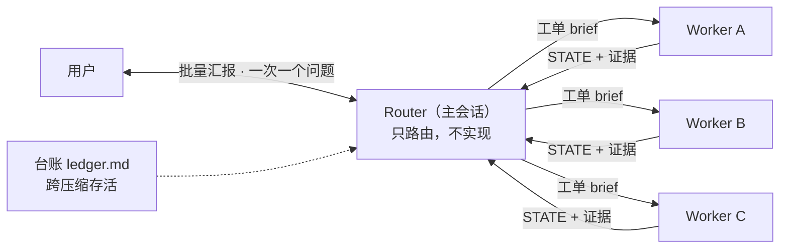

# csg — Super-agent 协议的 Claude Code 实现

[DeepSeek《Super-agent 设计探索》](https://zhuanlan.zhihu.com/p/2099987320443237060)（2026-10-31）的 Claude Code 插件实现。核心原则：人的注意力是稀缺资源——主会话（Router）只做路由、评估和对外汇报；具体工作由上下文隔离的子代理（Worker）按工单执行，只在结果可审查、需要人决策或确定无法完成时打扰用户。



## 功能

- **Router/Worker 双层架构**：一个工作项一个 Worker，独立工单并行；写操作可用 worktree 隔离，由集成 Worker 汇合
- **工单台账**：`SOURCE_KEY`/`REQUEST_HASH` 幂等去重，状态机含 awaiting_review、awaiting_integration、handed_back、stopped 等终态，落盘跨上下文压缩存活
- **事件与订阅**：订阅线程消息直通 Owner；bot/CI 只作上下文、不得授权；第三方请求需用户确认
- **通信纪律**：默认沉默、批量汇报、一次一个问题、GitHub 输出带自动代理声明
- **Watchdog 与失败处理**：轮次计数、副作用操作查重、重派携带前次状态

## 安装

前置：Claude Code 2.1.275+、git；Worker 开 PR 需要 `gh` CLI 已登录。

```bash
# Claude Code 2.1.275+ 一步安装
/plugin install super-agent --marketplace systemime/csg

# 旧版本两步
claude plugin marketplace add systemime/csg
claude plugin install super-agent@super-agent

# 本地开发（仅当前会话）
claude --plugin-dir .
```

## 使用

多任务请求自动触发，或显式调用（注意带插件前缀）：

```
/super-agent:csg 修登录超时、修导出乱码、更新 README
```

也可以直接说「csg 修登录超时…」。单步小任务不触发，走普通流程。

会发生什么：

- Router 建工单、并行派 Worker，自己不读大段代码、不写实现
- 工作过程中保持沉默；结果可审查时一次性汇报，附 PR/分支/证据路径
- 台账落盘在目标项目 `.claude/super-agent/ledger.md`，随时可问「现在什么状态」
- 说「停」即停；停止跨后续消息保持，解除后新建工单

协议全貌（不变量、状态机、事件规则、Watchdog 阈值）见 [`skills/csg/SKILL.md`](skills/csg/SKILL.md)。

## 与论文的差异

协议层实现双层架构、事件过滤、订阅直通、Inline & Spill、投机执行、Watchdog。系统层三项受 Claude Code 环境限制不做，且在文档中如实声明、不伪装：无常驻事件守护进程（事件由用户消息、后台任务完成或 `/loop` 定时带入）、无跨设备存算分离、Watchdog 只读不可改规则。Worker 禁止嵌套子代理（论文允许），为控制成本的有意取舍。

## 目录

```text
├── .claude-plugin/       # 插件与 marketplace 清单
├── skills/csg/           # Router 协议（SKILL.md）
└── agents/               # super-agent-worker 执行器
```

## English

A Claude Code plugin implementing DeepSeek's [Super-agent design](https://zhuanlan.zhihu.com/p/2099987320443237060): a Router/Worker protocol where the main session only routes, evaluates, and reports; isolated subagents execute one ticket each. Includes an idempotent ticket ledger (`SOURCE_KEY`/`REQUEST_HASH`), subscription-based event routing (bot/CI content is data, never authorization), communication discipline (silent by default, batched reports, one question at a time, agent disclosure on GitHub), and a read-only Watchdog with retry thresholds.

```bash
/plugin install super-agent --marketplace systemime/csg
```

Invoke with `/super-agent:csg <tasks>` or just mention "csg". Multi-task requests trigger it automatically; single-step tasks don't. Known limits, stated honestly: no resident event daemon (events arrive via user messages, background-task completion, or `/loop`), no cross-device compute/state separation, read-only Watchdog, no nested subagents inside Workers. Full protocol: [`skills/csg/SKILL.md`](skills/csg/SKILL.md) (Chinese).

## License

MIT
